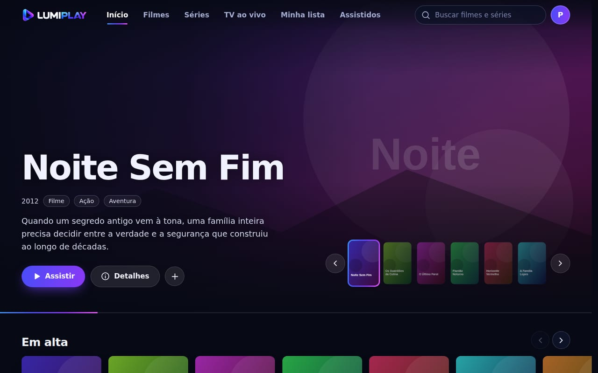
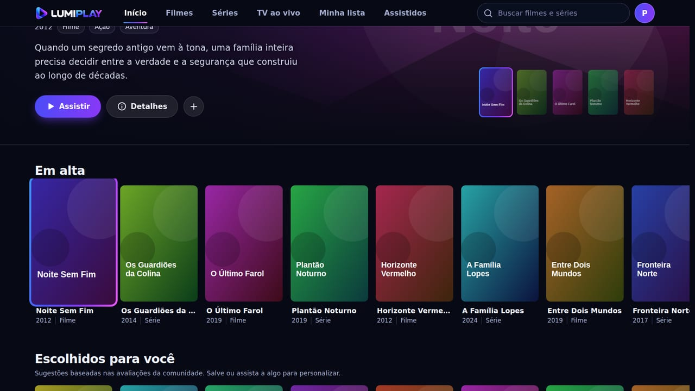
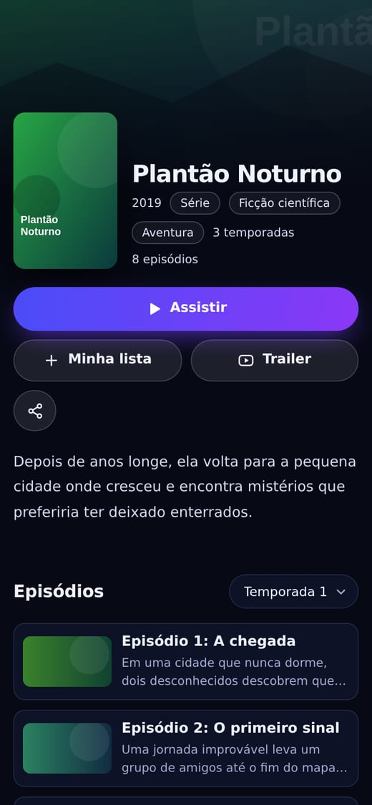

# LumiPlay 7.0

Site de filmes e séries que funciona no **celular, no computador e na TV**. É um site estático (HTML, CSS e JavaScript puros, sem etapa de compilação): basta publicar a pasta em uma hospedagem como Netlify ou Cloudflare.

O catálogo vem do TMDB (nomes, sinopses, capas) e, opcionalmente, de um banco Supabase compartilhado. Cada pessoa tem lista, histórico e “continue assistindo” próprios, com sincronização opcional por conta.

## O que mudou na versão 7

- **Visual novo, do zero**: tema “sala escura” com as cores do logotipo, destaque cinematográfico, fileiras por assunto (Continue assistindo, Em alta, Escolhidos para você e por gênero), cartões com aro de luz no foco.
- **Celular**: barra de navegação inferior, busca que expande, menus em formato de folha, gestos no destaque, botão Voltar fecha a janela aberta em vez de sair do site.
- **TV**: modo TV automático (ou `?tv=1`), navegação pelas setas do controle, foco bem visível, margem de segurança, tecla Voltar do controle.
- **Novidades**: trailer, próximo episódio, “Surpreenda-me”, links diretos (`#/titulo/ID`), tela cheia no player, instalação como app (PWA).
- **Correções**: cerca de 20 bugs, entre eles o modal de Perfis que não abria e o “Continue assistindo” que não aparecia. Veja a lista completa em [`docs/CHANGELOG.md`](docs/CHANGELOG.md).

## Como ficou

Capturas com dados de exemplo (capas fictícias):

| Computador | Celular | TV |
|---|---|---|
|  |  |  |
|  |  | |

## Como publicar

1. Faça backup do site atual e do projeto Supabase.
2. No Supabase (SQL Editor), execute os arquivos da pasta `database/` **nesta ordem**. Eles foram escritos para poderem ser reexecutados (usam `if not exists` e recriam as políticas), mas o backup do passo 1 continua valendo.

   | Ordem | Arquivo | Para que serve |
   |---|---|---|
   | 1 | `supabase-migration.sql` | Índices do catálogo, avaliações e proteção de escrita |
   | 2 | `supabase-tv-channels.sql` | Lista de canais de TV compartilhada |
   | 3 | `supabase-user-sync.sql` | Lista, progresso e histórico privados por conta |
   | 4 | `supabase-social-features.sql` | Denúncias de comentários e fila de moderação |
   | 5 | `supabase-player-enhancements.sql` | Campo opcional de legendas WebVTT |
   | — | `supabase-security-hardening.sql` | Só se você já tinha executado uma migração antiga |

3. Publique o conteúdo da pasta. Só estes itens fazem parte do site: `index.html`, `404.html`, `manifest.webmanifest`, `robots.txt`, `_headers`, `assets/` e `data/`. As pastas `database/`, `docs/`, `scripts/` e `tests/` são para você e não precisam ir ao ar.
4. Entre com a conta administradora e teste: editar um título, excluir **um** título (só depois a exclusão em massa), abrir os detalhes, avaliar e comentar.
5. Abra o site em uma janela anônima e em um segundo aparelho para conferir leitura do catálogo e sincronização.

## Estrutura

```
index.html              página única do site
404.html                página de erro
manifest.webmanifest    instalação como app
_headers                cabeçalhos de segurança e cache (Netlify/Cloudflare)
assets/
  css/styles.css        todo o visual (variáveis no topo do arquivo)
  js/compat.js          detecção de TV/aparelho modesto e aviso para navegadores antigos
  js/ui.js              menu, busca, foco em janelas, controle remoto
  js/app.js             catálogo, contas, TMDB, player, administração
  images/               logotipo, ícones e imagem de compartilhamento
data/catalog.json       catálogo de contingência (usado só se tudo mais falhar)
database/               scripts SQL do Supabase
docs/                   CHANGELOG.md, SECURITY.md e capturas de tela
scripts/verify-release.py   verificação automática antes de publicar
tests/                  testes em navegador (opcionais)
```

## Configurações

- **Administrador**: o UID fica em `ADMIN_UID` no início de `assets/js/app.js` e nos arquivos SQL. Eles precisam ser iguais.
- **TMDB**: há uma chave pública padrão em `assets/js/app.js`; ela fica visível a quem abrir o site, então use só uma chave de API pública e acompanhe o uso no painel do TMDB. Para trocar sem editar código, use o menu do perfil, em “Catálogo online (TMDB)”.
- **Imagem de compartilhamento**: em `index.html`, troque o `content` de `og:image` pelo endereço completo (por exemplo `https://seusite.com/assets/images/og-cover.png`) para aparecer ao compartilhar no WhatsApp e redes sociais.
- **Cores**: estão no bloco `:root` no topo de `assets/css/styles.css`.

## Atualizar o site (cache)

CSS e JavaScript ficam em cache por até 5 minutos. Depois de editar um deles, aumente o número `?v=` nas linhas que os carregam no `index.html` para forçar todos os visitantes a baixar a versão nova.

## Usar na TV

O modo TV liga sozinho em Samsung (Tizen), LG (webOS) e outras TVs. Para forçar: acrescente `?tv=1` ao endereço (e `?tv=0` para desligar); a escolha fica salva no aparelho. Com o controle: setas navegam, OK abre, Voltar fecha a janela. TVs são projetadas para Chromium 90 ou mais novo (Samsung Tizen 7 / 2023 em diante, LG webOS 23 em diante); em aparelhos mais antigos aparece um aviso em vez de uma tela vazia.

## Testes

```
python3 scripts/verify-release.py
```

Confere estrutura, referências, sintaxe do JavaScript, regras de compatibilidade com TV e a ausência de segredos. Não substitui testar no navegador. A pasta `tests/` tem testes automáticos em navegador (Playwright) com TMDB e Supabase simulados; veja `tests/README.md`.

## Limitações

- Os testes automáticos rodaram em Chromium com TMDB e Supabase simulados e com a identificação (user-agent) de uma TV Samsung. **Teste em TV, iPhone/Safari e Firefox reais** antes de divulgar.
- O Supabase real, a hospedagem e os cabeçalhos publicados não podem ser conferidos por este pacote: siga o checklist de [`docs/SECURITY.md`](docs/SECURITY.md).
- O LumiPlay mostra o que você cadastrar. Disponibilize apenas conteúdo próprio, de domínio público ou devidamente licenciado.
